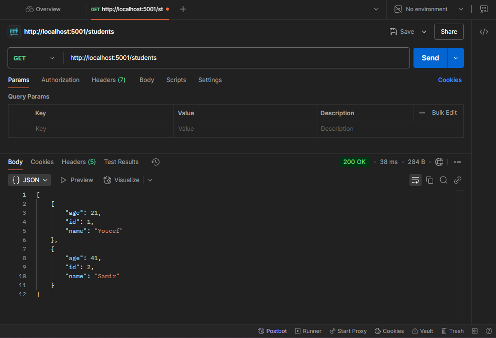

## RMI

rmi = (Remote method invocation)
il permet l'appel de methode sur machine distante

- le serveur cree l'objet reel
- le registry associer un nom a l'objet
  import java.rmi.registry.\*;
- le client cherche l'objet dans le registary puis utilise ces methodes.

- un stub : une representation local de l'objet que le client vas utilisé .
- RMI envoie l'appel par le reseaux pour l'executer sur le serveur et renvoyer le resultat.

import java.rmi.\*

public interface Hello extends Remote {
String sayHello(String name) throws RemoteException;
}
// extends Remote ici veux dire que les methodes peuvent etre appelé a distance

### implementation de l'objet :

// c'est le code qui s'execute coté serveur
import java.rmi.server._;
import java.rmi._;

// la class UnicastRemoteObject permet d'exporter l'objet

public class HelloImpl extends UnicastRemoteObject implements Hello {
public HelloImpl() throws RemoteException {}
public String sayHello(String name) {
return "Bonjour " + name + "!";
}
}

### serveur RMI

public class Server {
public static void main(String[] args) throws Exception {
HelloImpl obj = new HelloImpl();
LocateRegistry.createRegistry(1099);
Naming.rebind("rmi://localhost/Hello", obj);
System.out.println("Serveur pret !");
}
}

### Client RMI

import java.rmi.\*;

public class Client {
public static void main(String[] args) throws Exception {
Hello stub = {Hello} Naming.lookup("rmi://localhost/Hello");
System.out.println(stub.sayHello("Samir"));
}
}

## SOAP

(simple object access protocol) est un protocole d'echange de message en XML , generalement envoyer en http POST , le client : envoie une envelope XML qui dit quel operation appeler et avec quel parametres , le serveur : repond par une envelope XML.

### WSDL

(Web Services Description Language) est un fichier XML qui décrit le service : les opérations disponibles, leurs paramètres, leurs types de retour et l’adresse du service. C’est l’équivalent de l’interface Hello en RMI. Un outil comme SoapUI lit le WSDL et génère automatiquement les requêtes. Avec Spyne, il est généré tout seul à l’adresse http://localhost:8000/?wsdl

### exemple soap

// j'expliquerais tout ici apres le cours

### frontend

Interopérabilité : different languages communique entre eux (ici client php pour backend python ) , grace au service SOAP

- installer php
- dans php.ini, enlever le point virgule au debut de le ligne (;ex... = "soap")

## REST

permet l'interoperabilité , utilise json et pas xml comment

- installer flask

lancer avec : python app.py

